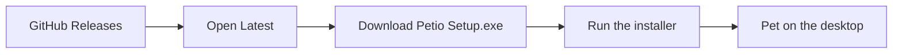
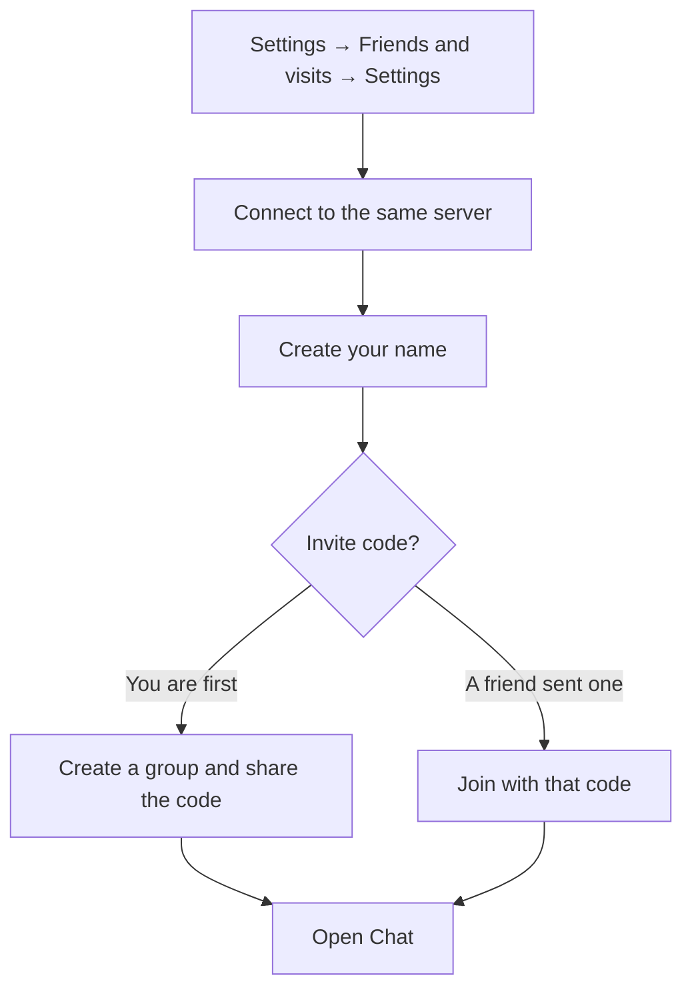

  
  &nbsp;
  

<h1 align="center">Petio</h1>

  A little companion that lives on your Windows desktop. 
  It wanders, reminds you, and can visit friends.

  <a href="#install-on-windows"><strong>Install</strong></a>
  &nbsp;·&nbsp;
  <a href="#how-to-use-petio"><strong>How to use</strong></a>
  &nbsp;·&nbsp;
  <a href="#chat"><strong>Chat</strong></a>
  &nbsp;·&nbsp;
  <a href="#the-companions"><strong>Companions</strong></a>

## The companions

| | Companion | Who they are | Signature |
| :---: | --- | --- | --- |
| 🐱 | **Miso** | Curious cat | Yarn pounce |
| 😈 | **Ember** | Sassy imp | Tiny trident |
| 🐝 | **Bumble** | Busy bee | Happy buzz |
| 👻 | **Boo** | Shy ghost | Vanish |
| 💤 | **Drowsy** | Sleepy snoozer | Big yawn |
| 🧙 | **Merlin** | Pocket witch | Spell sprinkle |
| 🐶 | **Luffy** | Rubber pup | Rubber punch |

## Install on Windows

> [!IMPORTANT]
> Download **Petio Setup** (the `.exe`) from the [latest release](https://github.com/y000yal/petio/releases/latest) on [GitHub Releases](https://github.com/y000yal/petio/releases). That page is the newest version. Skip older releases underneath it, and skip the zip unless you want the update files.

| Step | What to do |
| :---: | --- |
| **1** | Open [Releases](https://github.com/y000yal/petio/releases) and download the installer from the [latest release](https://github.com/y000yal/petio/releases/latest). |
| **2** | Run **Petio Setup**. Windows SmartScreen may say the publisher is unrecognized, because this build is not signed by a public certificate. Continue when the file came from that latest release. |
| **3** | Choose a folder and finish. Petio appears on the desktop and in the system tray, next to the clock. |
| **4** | Petio checks the [latest release](https://github.com/y000yal/petio/releases/latest) by itself. With **Auto download** off, it notifies you and waits. Turn **Auto download** on under **Habits & care** and it downloads the release, then asks you to restart. Your companion, reminders, and friend profile stay on this computer. |

## How to use Petio

Three gestures cover almost everything.

| | Gesture | Result |
| :---: | --- | --- |
| ✋ | **Drag** the pet | Move it around the desktop |
| 👆 | **Click** the pet | Open the action menu |
| 🕒 | **Click the tray icon** | Settings, friends, reminders, pause, hide, or **Quit Petio** |

> [!TIP]
> Quit from the tray before you install an update. Closing a chat or the settings window leaves Petio running.

> [!NOTE]
> A speech bubble is the pet talking. Clicking it does not open the menu. A 💬 mark above the pet means a new message is waiting. Click that mark to open the chat.

### The action menu

The buttons fan out around the pet.

| | Button | What it does |
| :---: | --- | --- |
| ✨ | **Special** | That companion’s trick: Miso pounces, Ember shows off, Bumble delivers pollen, Boo vanishes, Drowsy yawns, Merlin casts a spell, Luffy throws a punch |
| 📜 | **Chat** | Messages with your group. A number on the button is how many chats you have not opened |
| 🎮 | **Play** | Rock-paper-scissors, tic-tac-toe, jump, flip, dance, play dead |
| 🛋️ | **Rest and explore** | Stay, wander, nap, or move to the next screen when you have more than one |
| 🔔 | **Reminders** | The reminder list |
| ⚙️ | **Settings** | Companions, habits, reminders, and friends |
| ✖️ | **Close** | Puts the menu away. <kbd>Esc</kbd> does this too |

Close a chat with its **✕**. Clicking the desktop, pressing <kbd>Esc</kbd>, or starting a game leaves the chat open. While chat is open, the pet’s extra button stays hidden so it does not cover the conversation.

## Chat

Use the same server address as your friends. If that server asks for a registration code, tick **I have a registration code** and enter it.

The list on the left is the group and each friend.

| Mark | Meaning |
| :---: | --- |
| 🟢 | Online |
| ⚪ | Offline |
| dimmed row | Visits are off, so you cannot open that chat |

| Keys and buttons | What they do |
| --- | --- |
| <kbd>Enter</kbd> | Send |
| <kbd>Shift</kbd> + <kbd>Enter</kbd> | New line |
| Emoji, GIF, send | Sit inside the message box. A picked GIF or emoji stays highlighted until you send or clear it |
| Reply, react, **⋯** | Hover a message. Yours show the buttons on the left. Theirs show them on the right |
| **⋯ → Pin** | Pin or unpin. Pinned notes sit in a strip at the top. Click one to jump to it |
| **⋯ → Unsend** | Your own messages, for 30 minutes |
| Reaction row, then **+** | Short favorites first. **+** opens the full list. The same emoji again removes yours |
| Typing | Shows after three characters |
| ↓ | New messages below, when you are scrolled up |

## Visits

| | |
| :---: | --- |
| **On** | In **Friends & visits → Settings**, allow visits. Up to five pets can come over. Each visit lasts up to five minutes. |
| **Send** | Your pet leaves your desktop with a note. Your friend’s pet stays. Yours appears beside them. |
| **Home** | They can reply or send it home. You can recall yours from the tray while it is away. |
| **Off** | If their visits are off, the send is refused and you cannot choose them for a direct message. |

## Reminders

Open **Reminders** from the pet or the tray.

| | |
| --- | --- |
| **In** | Once |
| **Every** | Repeats |
| Time | Minutes or hours, from 1 minute to 168 hours |
| Limit | 50 reminders, 140 characters each |
| While closed | An overdue repeat is delivered once when Petio opens again, then set for the next time |
| Quiet hours | Optional window so a reminder only fires between the times you choose |

## Settings worth setting once

**Companions** is the wardrobe. Pick a character and press the button to use them. Size runs from **30%** to **90%**. The usual size is **65%**.

| Habit | What it changes |
| --- | --- |
| **Wander around** / **Walking speed** | Roaming |
| **Look at my cursor** | The head follows the pointer |
| **Explore all screens** | Boo glides, Merlin opens a portal, the others hop. One screen: they turn around at the edge |
| **Character zone** | Stay inside an area you draw |
| **Ask for attention** | Come to the screen you are using, then go back if you leave them alone |
| **Little conversations** | Short thoughts in the speech bubble |
| **Notice what I am doing** | May comment on the app in front. Only the app name and window title are read. They are not saved or sent |
| **Read my Windows notifications** | Off until you turn it on. The text is shown, not saved or sent |
| **Water reminders** | Gentle sip nudges through the day |
| **Soft character sounds** | Quiet notes. No background loop |
| **Stay above windows** | Keep the pet visible while you work |
| **Launch at login** | Start with Windows. Installed app only, under **Desktop**. Off when you run from source |

## For developers

| Command | What it does |
| --- | --- |
| `npm install` then `npm start` | Run Petio from this folder |
| `npm test` | Settings, reminders, movement, and chat checks |
| `npm run smoke` | Opens windows briefly. Uses `.smoke/` and leaves the installed pet alone |
| `npm run dist` | Builds **Petio Setup** into `release/`. Quit the tray app first |

Hosting notes: [DEPLOYMENT.md](DEPLOYMENT.md) for the Vercel and Neon server, [MULTIPLAYER.md](MULTIPLAYER.md) for two local clients.

| File | Role |
| --- | --- |
| `src/main.cjs` | Windows, tray, movement, storage |
| `src/renderer.js` | Drawing, speech bubble, action menu |
| `src/art.js` / `src/poses.js` | Characters and animation |
| `src/settings.*` | Wardrobe, habits, reminders |
| `src/preload.cjs` | The small bridge the windows are allowed to use |

Preferences live in `personality.json` in Electron’s user-data folder. Art is drawn on this computer. Friend chat sends messages, names, and invite codes only to the server address you enter. App names, window titles, and notification text stay here.

Older build notes

Drag leans on a damped spring. Jump and flip have anticipation, air time, and a landing. Bumble and Boo fly. Ember can summon a trident while idle, at least 45 seconds apart. Boo glides between monitors. Merlin uses portals. The others hop. Screen order is left to right, then top to bottom, including negative coordinates.

Idle animation is 15 fps. Active animation is 30 fps. Hidden or paused pets stop drawing. A short measurement on one computer saw about 0.8% CPU while idle. That sample is in `.smoke/performance.json`.

Attention visits default to every 15 minutes and return after 12 seconds if left alone. Reminders still fire while the pet is paused or hidden, including a Windows notification when the system allows it.

